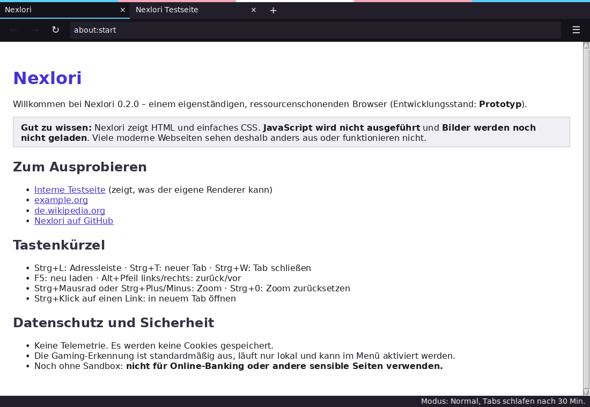

# Nexlori

**Ein eigenständiger, ressourcenschonender Browser für Gaming, Musik, Individualität und das echte Leben.**

Nexlori soll nicht einfach ein anderer Browser mit neuem Logo sein. Die Idee ist ein Browser mit eigener Identität, einer ruhigen und anpassbaren Oberfläche und Funktionen, die Rücksicht auf RAM, CPU, Akku und Datenverbrauch nehmen.

> **Wichtig zum Projektstand:** Nexlori ist derzeit ein Entwicklungsprojekt. Die Funktionen in dieser README beschreiben die Vision und Roadmap; sie sind noch nicht automatisch bereits implementiert oder einsatzbereit.

## Die Grundidee

Nexlori soll eine **eigene Browser-Engine** erhalten. Das Projekt soll nicht einfach Microsoft Edge, Chromium, Electron, CEF oder WebView2 umverpacken. Ziel ist eine eigenständige Architektur, die schrittweise entwickelt und getestet wird. Sicherheit, Web-Kompatibilität und Standards sollen dabei von Anfang an berücksichtigt werden.

Eine Browser-Engine von Grund auf zu entwickeln, ist ein großes Vorhaben. Deshalb soll Nexlori transparent zeigen, welche Webstandards bereits funktionieren und welche noch fehlen, anstatt vollständige Kompatibilität zu versprechen, bevor sie tatsächlich getestet wurde.

## Geplante Funktionen

### Weniger Ressourcenverbrauch

- **Intelligente Tab-Verwaltung:** Inaktive Tabs sollen möglichst wenig CPU und Arbeitsspeicher benötigen.
- **Ressourcenschonender Modus:** Animationen, Hintergrundaktivitäten und automatische Medienwiedergabe sollen sich reduzieren lassen.
- **Akku-Modus:** Auf Laptops sollen unnötige Hintergrundaufgaben nach Möglichkeit reduziert werden.
- **Klare Kontrolle:** Eine übersichtliche Anzeige soll zeigen, welche Tabs besonders viele Ressourcen benötigen, sobald diese Messungen zuverlässig verfügbar sind.

### Gaming-Erkennung und Gaming-Modus

Nexlori soll erkennen können, wann auf dem Gerät gerade gespielt wird, und den Browser darauf einstellen.

- Bei erkanntem Spielstart kann Nexlori optional in einen Gaming-Modus wechseln.
- Unnötige Hintergrundaktivitäten und Animationen sollen reduziert werden.
- Benachrichtigungen können während des Spielens leiser gestellt oder pausiert werden.
- Nach dem Spielen soll Nexlori auf Wunsch wieder zu den normalen Einstellungen zurückkehren.

**Datenschutzprinzip:** Die Erkennung soll freiwillig, transparent und lokal erfolgen. Sie soll keine Spielaktivitäten an einen Server melden. Nutzerinnen und Nutzer müssen die Funktion jederzeit abschalten können. Die konkrete Erkennung hängt vom Betriebssystem und den später verfügbaren Schnittstellen ab.

### Datensparmodus: weniger unnötiger Internetverkehr

Nexlori soll Datenverbrauch reduzieren, ohne ungefragt wichtige Inhalte zu verändern.

- Automatische Medienwiedergabe standardmäßig vermeiden oder kontrollierbar machen.
- Bilder bei Bedarf in einer niedrigeren Qualität laden.
- Tracker und unnötige Drittanbieter-Anfragen nach Möglichkeit blockieren.
- Hintergrundladen und Vorabladen von Seiten kontrollierbar machen.
- Zwischenspeicherung sinnvoll nutzen und den Datenverbrauch verständlich anzeigen.
- Einfache Schalter für den normalen Modus und einen besonders sparsamen Modus anbieten.

Einige Seiten funktionieren mit blockierten Skripten oder Trackern möglicherweise nicht richtig. Deshalb soll der Schutz anpassbar bleiben. Nexlori soll außerdem offen erklären, welche Einsparungen tatsächlich gemessen wurden, statt unbelegte Prozentwerte zu versprechen.

### Musik-Popups und Mediensteuerung

Musik soll nicht jedes Mal den ganzen Bildschirm übernehmen müssen.

- Ein kleines, frei platzierbares Musik-Popup mit Wiedergabe, Pause und Titelsprüngen.
- Schneller Zugriff auf Medien, die in unterstützten Tabs abgespielt werden.
- Einstellbare Position, Größe und Sichtbarkeit des Popups.
- Auf Wunsch dezente Benachrichtigungen beim Titelwechsel.
- Eine Möglichkeit, das Popup vollständig auszuschalten.

Die Bedienung soll nur mit unterstützten Medienquellen funktionieren und keine Musikdienste ohne deren Zustimmung oder Schnittstellen nachahmen.

### LGBTQ+-Themes und persönliche Gestaltung

Nexlori soll ein Browser sein, in dem Menschen ihre Persönlichkeit zeigen können.

- LGBTQ+-Themes, darunter verschiedene Pride-Farbwelten.
- Frei einstellbare Akzentfarben, Hintergründe und Tab-Designs.
- Ruhige, kontrastreiche und dunkle Designs.
- Eigene Themes und Profile, die sich schnell wechseln lassen.
- Keine Pflicht, persönliche Angaben zur Identität zu machen.

### Eine angenehme, zugängliche Oberfläche

- Eine übersichtliche Bedienung ohne unnötige Pop-ups.
- Wahlweise eine ruhige Oberfläche mit wenigen Ablenkungen.
- Anpassbare Animationen, Kontraste, Schriftgrößen und Tastaturbedienung.
- Klare Sprache und nachvollziehbare Einstellungen.
- Datenschutzfreundliche Voreinstellungen und möglichst wenig Telemetrie.

## Leitlinien

1. **Eigenständig:** Die langfristige Vision ist eine eigene Engine und keine umbenannte Chromium- oder Edge-Version.
2. **Ressourcenschonend:** RAM, CPU, Akku und Datenverkehr sollen sparsam eingesetzt werden.
3. **Privatsphäre zuerst:** Gaming-Erkennung und Nutzungsdaten sollen lokal und freiwillig bleiben, wo immer möglich.
4. **Inklusiv:** Themes und Bedienung sollen unterschiedliche Menschen und Bedürfnisse berücksichtigen.
5. **Ehrlich:** Funktionen und Web-Kompatibilität werden erst dann als fertig bezeichnet, wenn sie implementiert und getestet wurden.
6. **Sicher:** Sicherheitsgrenzen, Updates und Schutz vor schädlichen Webseiten sind Voraussetzung für einen öffentlichen Browser.

## Projektstand der Umsetzung

Stand: **Prototyp 0.3.0** – die Browser-Oberfläche nutzt jetzt Qt WebEngine/Chromium. Damit funktionieren die meisten modernen Webseiten deutlich vollständiger als mit dem alten eigenen Renderer. Eine Garantie für jede Website gibt es trotzdem nicht: Einige Dienste benötigen spezielle DRM-Komponenten, besondere Systemfunktionen oder blockieren eingebettete Browser.



### Nexlori.exe bekommen

Die EXE wird von GitHub Actions gebaut (Workflow **„Windows-EXE“**):

1. **Probebau:** *Actions* → *Windows-EXE* → *Run workflow*. Nach dem Lauf unter *Artifacts* `Nexlori-Windows-x64`
   herunterladen (ZIP mit `Nexlori.exe` und `Nexlori.exe.sha256`).
2. **Release:** `git tag v0.2.0 && git push origin v0.2.0` – der Workflow hängt die EXE dann automatisch an ein
   GitHub-Release (als Vorabversion).

Der Workflow führt vor dem Bauen alle Tests aus und startet danach die gebaute EXE mit `--selftest`.
Die EXE ist **nicht signiert**: Windows SmartScreen zeigt beim ersten Start „Der Computer wurde durch Windows
geschützt“ (→ *Weitere Informationen* → *Trotzdem ausführen*), und Virenscanner melden bei solchen Programmen
gelegentlich Fehlalarme. Mit `Nexlori.exe.sha256` lässt sich die Datei prüfen. Einstellungen liegen in
`%APPDATA%\Nexlori\settings.json`; falls etwas abstürzt, steht Näheres in `crash.log` im selben Ordner.

### Was heute vorhanden und getestet ist

| Bereich | Heute vorhanden | Noch offen |
|---|---|---|
| Fenster-App | Tabs, neue Fenster als Tabs, Adressleiste, Suche, Verlauf, Lesezeichen, Downloads, Zoom, Seitensuche, Themes und Seiten-Theme-Schalter | Drucken, Passwortverwaltung, Synchronisierung |
| Web-Engine | Qt WebEngine/Chromium: JavaScript, moderne CSS-Layouts, Bilder, Formulare, Cookies, Local Storage und Web-APIs | Einige DRM-Dienste, spezielle Plattformfunktionen und Websites, die eingebettete Browser blockieren |
| Seiten-Theme | Lokales CSS färbt Hintergründe, Text, Links und Formulare passend zum gewählten Theme; Bilder und Medien bleiben unverändert | Einzelne Websites können durch ihre eigenen Styles das Ergebnis begrenzen; pro Website abschaltbar (globaler Schalter) |
| Ressourcenschonung | Modi (Normal, Ressourcenschonend, Akku, Gaming); inaktive Tabs geben ihren Speicher frei und laden beim Zurückwechseln neu | echte RAM-/CPU-Messung pro Tab |
| Datensparmodus | Filterlogik (Tracker, Autoplay, Vorabladen, strikt) und Einsparungsbuch getestet. Die App lädt ohnehin nur das HTML-Dokument selbst – keine Skripte, Bilder oder Tracker | Einhängen des Filters, sobald Unterressourcen geladen werden |
| Gaming-Erkennung | im Menü freiwillig einschaltbar (standardmäßig aus), rein lokal, optional automatischer Gaming-Modus | Praxistests gegen Fehlerkennungen |
| Musik-Popup | Modell und Steuerlogik getestet; in der App noch nicht sichtbar (es gibt noch keine Medienwiedergabe) | sichtbares Popup, echte Medienquellen |
| Themes | Basis-, Gothic-, Cyberpunk-, Wald-, Ozean-, Sakura-, Kaffee- und Mitternacht-Themes sowie Regenbogen-, Gay-, Trans-, Bi-, Pan-, Lesben-, Genderfluid-, Nichtbinär-, Asexuell-, Aromantisch- und Queer-Pride-Themes | Eigene Theme-Editor-Oberfläche |
| Sicherheit | – | Sandboxing/Prozess-Isolation, Updates, Parser-Fuzzing ([Architektur](docs/ARCHITECTURE.md)) |

**Noch nicht für Online-Banking oder andere sensible Seiten verwenden.**

### Entwickeln

```bash
python -m venv .venv && source .venv/bin/activate    # Windows: .venv\Scripts\activate
pip install -e ".[dev,gaming]"
nexlori gui                                          # Fenster starten (optional mit Adresse)
nexlori render examples/hello.html examples/hello.png
pytest                                               # Fenster-Tests laufen nur mit Display (Windows oder xvfb-run)
pip install pyinstaller && python packaging/build_exe.py   # baut dist/Nexlori(.exe)
```

## Roadmap

- [x] Projektstruktur und technische Architektur dokumentieren ([docs/ARCHITECTURE.md](docs/ARCHITECTURE.md))
- [ ] Zielplattform und erste unterstützte Webstandards festlegen
- [x] Eigenständigen, experimentellen Rendering-Prototyp entwickeln (erste Stufe: Teilmenge von HTML/CSS → Bild)
- [ ] Netzwerkzugriff, Zertifikatsprüfung und Sicherheitskonzept entwerfen
- [ ] Messungen für RAM-, CPU- und Datenverbrauch integrieren
- [ ] Datenschutzfreundlichen Datensparmodus entwickeln
- [ ] Musik-Popup und Mediensteuerung umsetzen
- [ ] Freiwillige lokale Gaming-Erkennung erforschen
- [ ] LGBTQ+-Themes und barrierearme Oberflächen entwickeln
- [ ] Tests, Sicherheitsprüfungen und transparente Kompatibilitätsübersicht aufbauen

Die Reihenfolge kann sich während der Entwicklung ändern. Sicherheit und eine nachvollziehbare technische Grundlage haben Vorrang vor einer langen Feature-Liste.

## Mitmachen

Ideen, Fehlerberichte und Verbesserungsvorschläge sind willkommen. Bitte kennzeichne in Vorschlägen klar, ob es um eine bereits vorhandene Funktion oder um einen zukünftigen Wunsch geht.

**Nexlori – dein Browser, deine Ressourcen, dein Stil.**

### Webseiten-Themes

Mit der Schaltfläche **Aa** kannst du die Farben einer geöffneten Website an dein aktives Nexlori-Theme anpassen. Das lokale Stylesheet wird nur im Browser angewendet und nicht an die Website gesendet. Manche Seiten können dadurch anders aussehen; der Schalter lässt sich jederzeit deaktivieren.

Die Oberfläche bietet unter anderem Gothic, Cyberpunk, Kaffee, Wald, Ozean, Sakura, Mitternacht sowie Pride-Themes für Gay, Regenbogen, Trans, Bi, Pan, Lesben, Genderfluid, Nichtbinär, Asexuell, Aromantisch und Queer.
